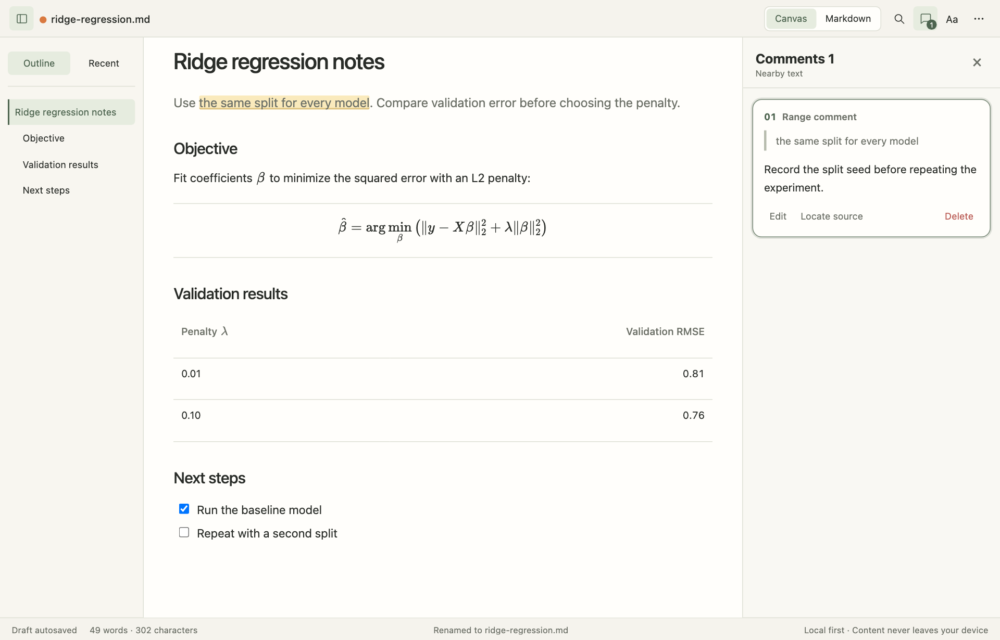
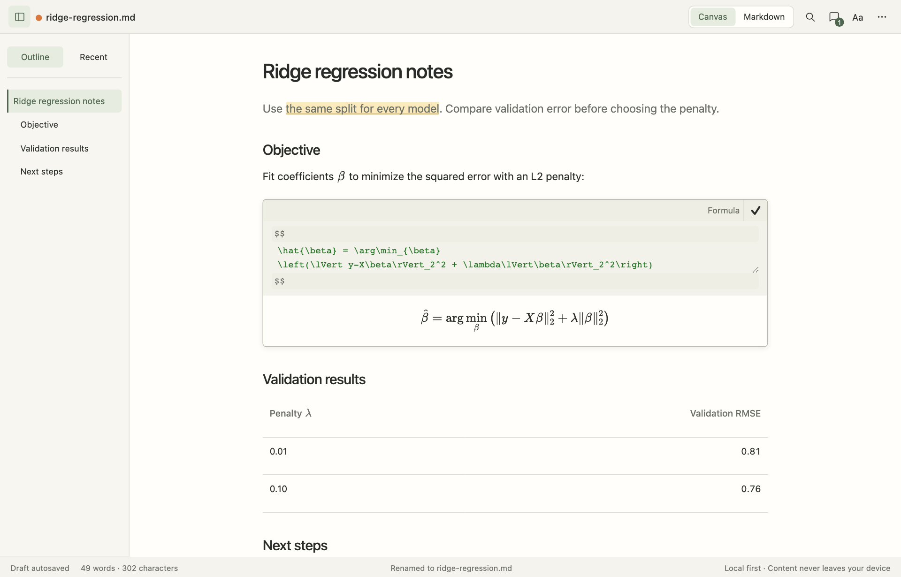
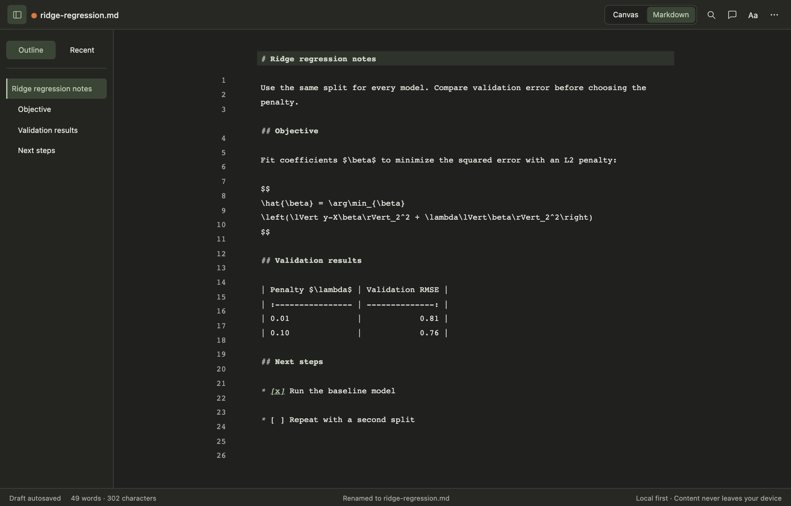

<p align="center">
  <a href="README.md">繁體中文</a> ·
  <a href="README.zh-CN.md">简体中文</a> ·
  <strong>English</strong>
</p>

<p align="center">
  
</p>

<h1 align="center">PaperCanvas</h1>

<p align="center">
  A desktop Markdown editor for research notes, mathematics, and technical writing. Switch between the visual canvas and Markdown source. Your documents are local UTF-8 text files.
</p>

<p align="center">
  <a href="https://williamzheng0711.github.io/paper-canvas/download/PaperCanvas-Windows-x64-Setup.exe">Download for Windows</a>
  ·
  <a href="https://williamzheng0711.github.io/paper-canvas/download/PaperCanvas-macOS-universal.dmg">Download for macOS</a>
</p>

The published installers are **v0.2.0**. The guide and screenshots below use the current development build, which includes changes made after that release.

<p align="center">
  <a href="docs/assets/papercanvas-editor.png">
    
  </a>
</p>

## Install

- **macOS (Intel and Apple Silicon)**. Open the DMG and drag PaperCanvas into Applications. Open PaperCanvas from that folder. If macOS blocks the first launch, verify that you used the download link above. In System Settings, go to Privacy & Security and select Open Anyway.
- **Windows 10/11 (x64)**. Run the installer and follow its prompts. Open PaperCanvas from the Start menu. If SmartScreen shows an unknown publisher, verify the source of the installer, then select More info and Run anyway.

After installation, use Finder or File Explorer to open a `.md` or `.markdown` file with PaperCanvas.

## Edit and read

- **Canvas / Markdown**. Edit formatted text, tables, task lists, and footnotes in Canvas, or switch to Markdown source with syntax highlighting and line numbers. Documents that exceed Canvas limits open in Markdown mode, where you can edit and save the full source.
- **Equations**. Use `$…$` for inline math. For display math, put `$$` on its own line before and after the equation. Click an equation in Canvas to edit its LaTeX and see a live KaTeX preview.
- **Outline and find**. Use Outline in the left sidebar to jump to headings, or use Recent to reopen a file. Press `⌘/Ctrl + F` to find text in either mode.
- **Comments**. In Canvas, select text or place the cursor, then right-click and choose New comment. Use the speech bubble in the toolbar to open the comments panel and jump to the relevant text.
- **Reading settings**. Open **Aa** to change the font, text size, line spacing, or switch between light and dark themes. You can also set the interface language to English, Simplified Chinese, or Traditional Chinese.

<table>
  <tr>
    <td width="50%">
      <a href="docs/assets/papercanvas-formula-editor.png"></a>
    </td>
    <td width="50%">
      <a href="docs/assets/papercanvas-markdown-source.png"></a>
    </td>
  </tr>
  <tr>
    <td>LaTeX equation editor</td>
    <td>Markdown source mode</td>
  </tr>
</table>

## Save and export

- Open **⋯** on the right of the toolbar to create, open, save, or rename a document, or use Save as to choose a new location. PaperCanvas automatically saves edits to files that already have a location. Before the first save, it keeps a local recovery draft.
- Drag or paste images into Canvas and drag the handles to resize them. When you save `notes.md`, PaperCanvas can store newly added image files in the adjacent `notes.assets/` folder. Include the referenced images and asset folder when you move or share the document.
- PaperCanvas stores document comments in an HTML comment at the end of the Markdown file. They travel with the file when you share it. Preferences, recent files, and recovery drafts stay on your device. PaperCanvas requires no account and has no telemetry or cloud sync. Documents with HTTPS images can load them from their original sites.
- In the **⋯** menu, open Export and choose Markdown or PDF. Markdown export saves a copy. On macOS, you can save a PDF directly. On Windows, save to PDF through the system print dialog.

## Run from source

Use Node.js 22, as in the automated checks. Install Rust and the [Tauri prerequisites](https://v2.tauri.app/start/prerequisites/) for your operating system. Run the following commands in the repository root.

```bash
npm ci
npm run tauri dev
```

Use `npm run dev` to try the editor in a browser. Use the desktop app to test native open and save dialogs, file associations, and local image access.

```bash
npm run lint
npm test -- --maxWorkers=2
npm run test:perf
npm run build
cargo test --manifest-path src-tauri/Cargo.toml
```

See the [QA guide](docs/QA.md) for manual checks of the native clipboard, input methods, file associations, and export.

## License

[Apache License 2.0](LICENSE)
