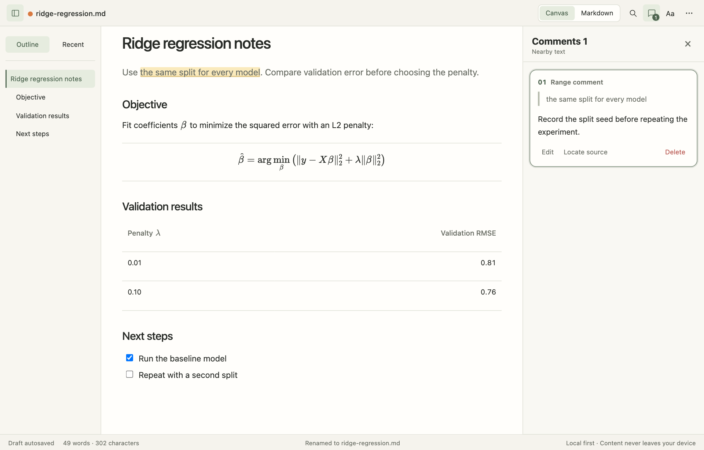

  

<h1 align="center">PaperCanvas</h1>

  一個以本機檔案為主的 Markdown 桌面編輯器，適合整理研究筆記、數學內容與技術文件。

  PaperCanvas 仍在持續改進中，希望在保留一般 Markdown 檔案的前提下，提供較直覺的寫作方式。

  <a href="https://williamzheng0711.github.io/paper-canvas/download/PaperCanvas-Windows-x64-Setup.exe?v=0.1.2">下載 Windows 版</a>
  ・
  <a href="https://williamzheng0711.github.io/paper-canvas/download/PaperCanvas-macOS-universal.dmg?v=0.1.2">下載 macOS 版</a>

  

## 關於

PaperCanvas 將內容儲存為 UTF-8 Markdown 檔案，讓文件可以繼續由其他文字編輯器開啟與修改。圖片會存放在文件旁的資源資料夾，不需要建立帳號，也不依賴雲端服務。

目前提供的主要功能包括：

- 視覺化編輯與 Markdown 原始碼編輯
- LaTeX 數學公式輸入與預覽
- 本機圖片管理
- 一般桌面檔案操作

## 安裝

### macOS

下載並開啟 DMG，將 PaperCanvas 拖入「應用程式」後即可開啟。安裝檔同時支援 Intel 與 Apple Silicon Mac。

如果 macOS 阻止首次開啟，請先確認檔案來自本儲存庫，再前往「系統設定」的「隱私權與安全性」，選擇「仍要打開」。

### Windows

下載並執行安裝程式，再依照畫面提示完成安裝。目前支援 64 位元的 Windows 10 與 Windows 11。

在程式完成正式簽署之前，Windows 可能顯示發行者不明的提醒。請先確認檔案來源，再決定是否繼續安裝。

## 隱私

PaperCanvas 目前沒有帳號、遙測、雲端同步或協作服務。文件保留在使用者選擇的位置；最近開啟的檔案路徑與偏好設定則由應用程式儲存在本機。

## 授權

本專案採用 [Apache License 2.0](LICENSE) 授權條款。
