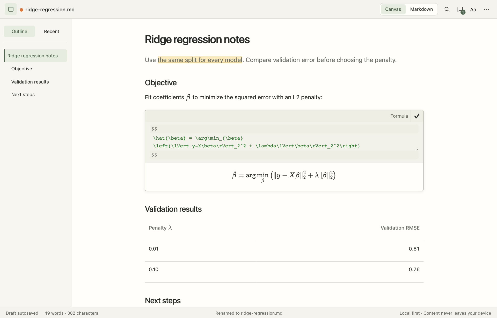
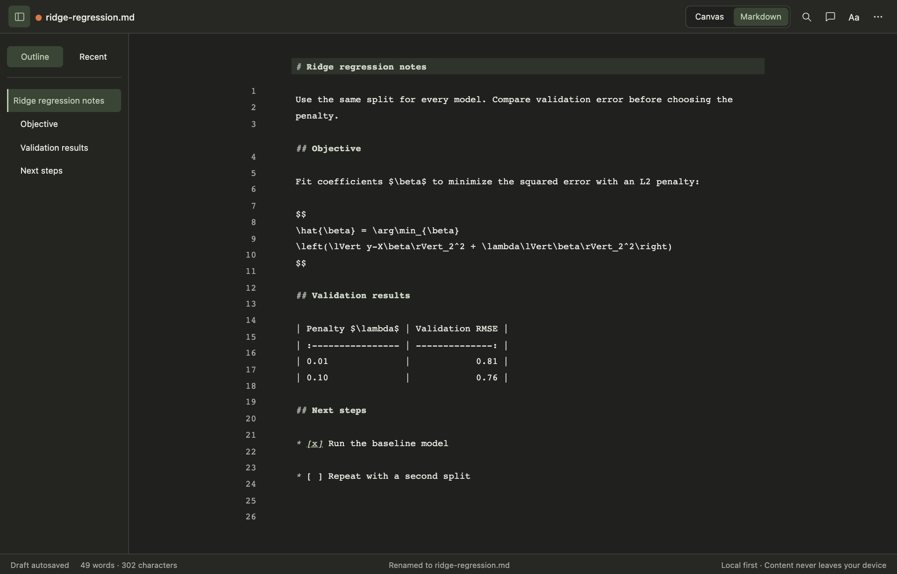
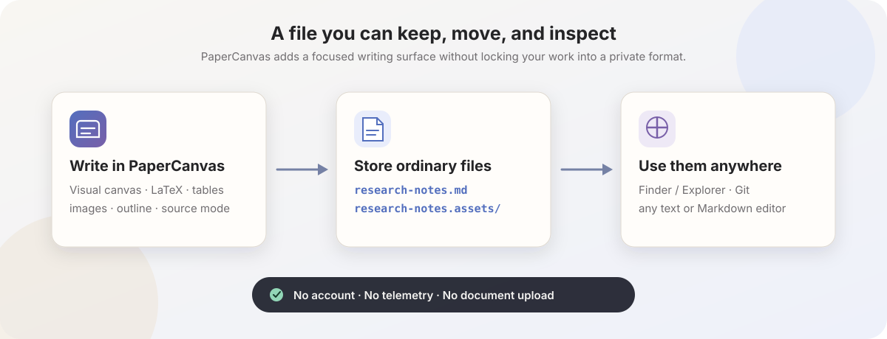

<p align="center">
  
</p>

<h1 align="center">PaperCanvas</h1>

<p align="center">
  <strong>A calm, local-first desktop canvas for research notes, mathematics, and technical writing.</strong>
</p>

<p align="center">
  Your documents stay as readable UTF-8 Markdown files. PaperCanvas adds a focused visual editor, live LaTeX, local image assets, and native desktop file handling—without an account or cloud service.
</p>

<p align="center">
  
  
  
  <a href="LICENSE"></a>
</p>

<p align="center">
  <a href="https://github.com/williamzheng0711/paper-canvas/releases/latest/download/PaperCanvas-Windows-x64-Setup.exe">
    
  </a>
  <a href="https://github.com/williamzheng0711/paper-canvas/releases/latest/download/PaperCanvas-macOS-universal.dmg">
    
  </a>
</p>

<p align="center">
  <sub>Windows 10/11 x64 · macOS Intel and Apple Silicon · Each button downloads the newest release directly.</sub>
</p>

<p align="center">
  <a href="#install-on-macos">Install on macOS</a> ·
  <a href="#install-on-windows">Install on Windows</a> ·
  <a href="#development">Development</a> ·
  <a href="#privacy-and-file-format">Privacy</a>
</p>

<p align="center">
  <a href="docs/assets/papercanvas-editor.png">
    
  </a>
</p>

<p align="center"><sub>The real PaperCanvas interface, captured from this repository.</sub></p>

> [!IMPORTANT]
> Desktop installers are built from each version tag by [the release workflow](.github/workflows/release-desktop.yml). The two download buttons always resolve to the matching installer in the latest GitHub Release; no Node.js, Rust, Git, or source build is required to install PaperCanvas.

## Why PaperCanvas

- **A visual canvas, not a permanent split view.** Write in one Tiptap/ProseMirror document and switch to an editable CodeMirror Markdown source mode only when you need it.
- **Mathematics that remains LaTeX.** Inline and display formulas render with KaTeX. Click any formula to edit its source beside a live preview.
- **Files you control.** Create, open, rename, auto-save, export, and reopen local `.md` and `.markdown` documents. Installed builds register both file types with Finder or Explorer.
- **Portable images.** Paste or drag images, resize them on the canvas, and save them beside the document under `<document>.assets/` with relative Markdown references.
- **Content-preserving by design.** Unsupported Markdown or sanitized HTML stays visible and round-trips as source instead of disappearing silently.
- **Built for long technical documents.** Outline navigation, tables, task lists, highlighted code blocks, word counts, themes, font controls, adjustable spacing, and English, 简体中文, and 繁體中文 UI are included.

<table>
  <tr>
    <td width="50%">
      <a href="docs/assets/papercanvas-formula-editor.png">
        
      </a>
    </td>
    <td width="50%">
      <a href="docs/assets/papercanvas-markdown-source.png">
        
      </a>
    </td>
  </tr>
  <tr>
    <td><strong>Live formula editing</strong><br><sub>LaTeX source and KaTeX preview stay together while you edit.</sub></td>
    <td><strong>Real Markdown source mode</strong><br><sub>CodeMirror provides an editable, highlighted source view—not a read-only preview.</sub></td>
  </tr>
</table>

## Privacy and file format

<p align="center">
  
</p>

PaperCanvas has no telemetry, account system, sync service, collaboration backend, or AI/network feature. Documents remain where you save them. Recent-file paths and preferences are stored in the operating system's Tauri application-data directory.

The native shell grants only the file capabilities needed for open, save, rename, image assets, and export. A user-selected file remains accessible after restart through Tauri's persisted scope; unrelated files are not exposed to the editor.

## Install on macOS

1. Click **Download for macOS** above to download `PaperCanvas-macOS-universal.dmg`.
2. Open the downloaded DMG.
3. Drag **PaperCanvas** into **Applications**, eject the DMG, and open PaperCanvas from Applications.

The same installer contains native Intel (`x86_64`) and Apple Silicon (`arm64`) executables, so users do not need to choose a processor-specific download.

> [!NOTE]
> If a release is ad-hoc signed rather than Developer ID signed and notarized, macOS may block its first launch. Confirm that the DMG came from this repository, then open **System Settings → Privacy & Security** and choose **Open Anyway** for PaperCanvas. The release workflow automatically switches to Developer ID signing and notarization when the required Apple secrets are configured.

## Install on Windows

1. Click **Download for Windows** above to download `PaperCanvas-Windows-x64-Setup.exe`.
2. Run the downloaded installer and follow its prompts.
3. Launch **PaperCanvas** from the Start menu or open a `.md` or `.markdown` file with it.

The installer targets standard 64-bit Intel/AMD Windows 10 and Windows 11 computers. It checks for Microsoft Edge WebView2 and downloads the runtime when Windows does not already provide it.

> [!NOTE]
> Until an Authenticode certificate is configured, Microsoft Defender SmartScreen may warn that the publisher is unknown. Confirm that the installer came from this repository, then choose **More info → Run anyway** to continue.

## Run in development

After completing the prerequisites for your operating system:

```bash
npm ci
npm run tauri dev
```

The browser-only frontend can be started with `npm run dev`, but native open/save dialogs, file associations, local image access, and direct macOS PDF export require `npm run tauri dev`.

## Development

PaperCanvas uses React 19, Tiptap/ProseMirror, CodeMirror 6, KaTeX, Tauri 2, and a small Rust native layer.

Useful validation commands:

```bash
npm run lint
npm test
npm run test:perf
npm run build
```

The tests cover Markdown ↔ editor-document round trips, math delimiters, unsupported-content retention, live formula editing, formula boundary navigation, image behavior, auto-save stability, PDF export logic, and a create → formula → UTF-8 Markdown save/reopen smoke path. `npm run test:perf` measures the local parse/serialize path for a 50,000-character Chinese document; it is not a universal UI or IME latency claim.

Use [docs/QA.md](docs/QA.md) for native clipboard, image, file-association, export, and window checks before a release.

### Troubleshooting

| Symptom                                                | What to check                                                                                                                |
| ------------------------------------------------------ | ---------------------------------------------------------------------------------------------------------------------------- |
| `EBADENGINE` or `node --version` is not `v22.x`        | Put the Node.js 22 binary directory first in `PATH`, reopen the terminal, and rerun `npm ci`.                                |
| `Cannot find module '@rollup/rollup-darwin-arm64'`     | On Apple Silicon, run `npm ci --include=optional`, then retry the command.                                                   |
| An Apple Silicon build contains an `x86_64` executable | Confirm `rustc -Vv` uses rustup's `aarch64-apple-darwin` host, run `cargo clean --release` inside `src-tauri`, then rebuild. |
| Windows reports that `link.exe` is missing             | Modify Visual Studio Build Tools and install the **Desktop development with C++** workload plus a Windows SDK.               |
| Tauri refers to a previous checkout path               | Run `cargo clean --release` inside `src-tauri`, return to the repository root, and rebuild.                                  |

## Markdown and mathematics support

PaperCanvas intentionally supports a focused Markdown subset: headings, paragraphs, emphasis, strike-through, inline code, links, lists and task lists, block quotes, rules, fenced code, GFM tables, images, and the math forms below.

- Inline math: `$...$` and `\(...\)`.
- Display math: standalone `$$...$$` and multiline `\[...\]`.
- Standalone KaTeX environments including `equation`, `align`, `gather`, `aligned`, `cases`, and common matrix variants.
- Everyday KaTeX constructs such as fractions, scripts, roots, Greek letters, `\mathbb`, `\mathbf`, and `\operatorname`.

Arbitrary TeX packages, journal templates, custom macro preferences, formula numbering, labels, references, and general HTML execution are not supported. Invalid KaTeX stays in the document as source with a local warning; it does not crash or silently delete the document.

PaperCanvas is its own design and asset set. It aims for a low-distraction, single-page writing experience without claiming complete Markdown, TeX, or Typora compatibility.

## Known limits

- No sync, collaboration, command palette, spelling dictionaries, or typewriter/focus mode yet.
- Tables round-trip through GFM but do not yet have a spreadsheet-style cell toolbar.
- PDF export is direct on macOS; other platforms currently use their system print flow.
- Public releases still need macOS Developer ID signing/notarization and Windows Authenticode signing.

## License

PaperCanvas is available under the [Apache License 2.0](LICENSE).
