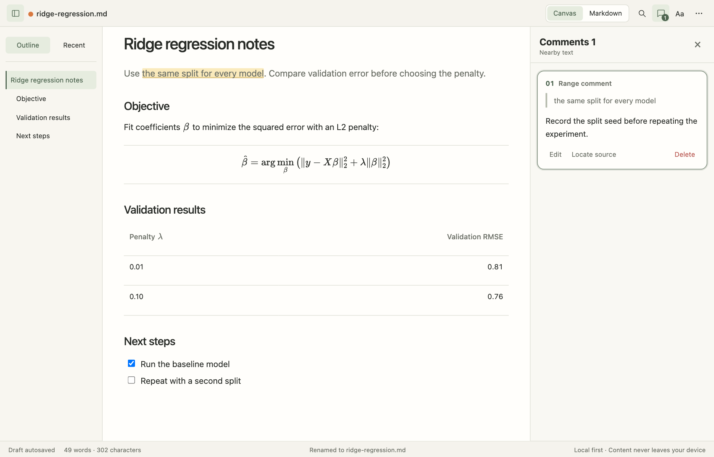
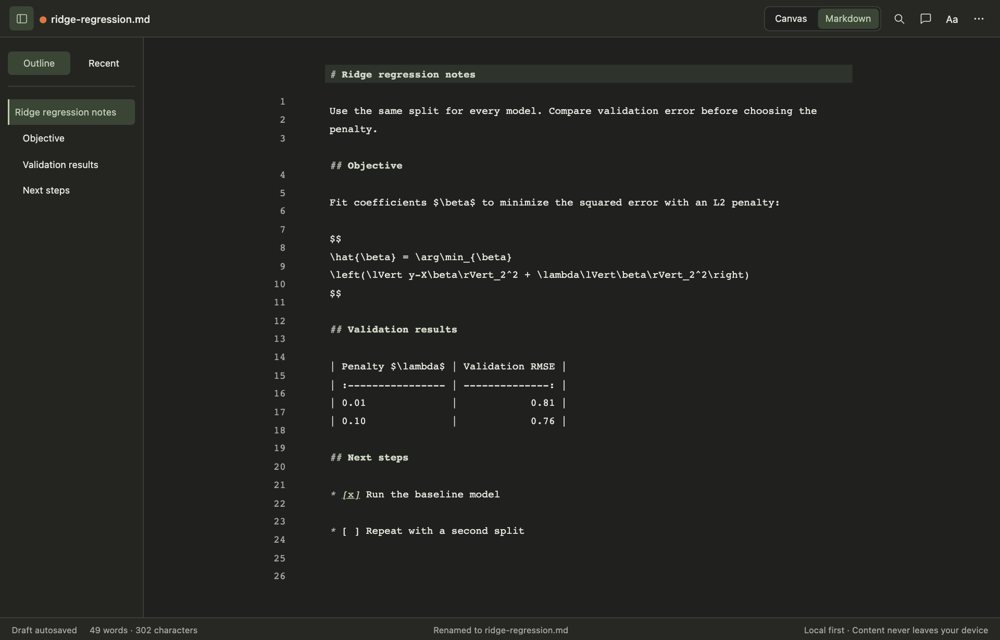
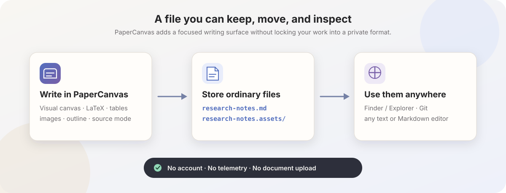

<p align="center">
  <a href="README.md">繁體中文</a> ·
  <strong>简体中文</strong> ·
  <a href="README.en.md">English</a>
</p>

<p align="center">
  
</p>

<h1 align="center">PaperCanvas</h1>

<p align="center">
  <strong>一张安静、在本地优先运行的桌面画布，适合研究笔记、数学内容与技术写作。</strong>
</p>

<p align="center">
  文档始终保存为可直接阅读的 UTF-8 Markdown 文件。PaperCanvas 在此基础上提供专注的可视化编辑器、实时 LaTeX、本地图像资源与原生桌面文件操作，而且不需要账号或云服务。
</p>

<p align="center">
  
  
  
  <a href="LICENSE"></a>
</p>

<p align="center">
  <a href="https://williamzheng0711.github.io/paper-canvas/download/PaperCanvas-Windows-x64-Setup.exe?v=0.1.1">
    
  </a>
  <a href="https://williamzheng0711.github.io/paper-canvas/download/PaperCanvas-macOS-universal.dmg?v=0.1.1">
    
  </a>
</p>

<p align="center">
  <sub>当前安装包版本：v0.1.1 · Windows 10/11 x64 · macOS Intel 与 Apple Silicon · 每个按钮都会直接下载最新版本。</sub>
</p>

<p align="center">
  <a href="#在-macos-上安装">在 macOS 上安装</a> ·
  <a href="#在-windows-上安装">在 Windows 上安装</a> ·
  <a href="#开发">开发</a> ·
  <a href="#隐私与文件格式">隐私</a>
</p>

<p align="center">
  <a href="docs/assets/papercanvas-editor.png">
    
  </a>
</p>

<p align="center"><sub>本仓库中实际运行的 PaperCanvas 界面。</sub></p>

> [!IMPORTANT]
> 桌面安装包会由[发布工作流](.github/workflows/release-desktop.yml)根据每个版本标签构建，再由 [Pages 工作流](.github/workflows/publish-downloads.yml)复制到公开下载站点。安装 PaperCanvas 不需要 Node.js、Rust、Git、GitHub 账号，也不需要从源代码构建。

## 为什么选择 PaperCanvas

- **可视化画布，而不是固定的分栏视图。** 在同一份 Tiptap/ProseMirror 文档中写作，只在需要时切换到可编辑的 CodeMirror Markdown 源码模式。
- **数学公式仍然是 LaTeX。** 行内与独立公式使用 KaTeX 渲染。点击任意公式，即可在实时预览旁编辑其源代码。
- **文件由你掌控。** 创建、打开、重命名、自动保存、导出并重新打开本地 `.md` 与 `.markdown` 文档。安装后的应用会在 Finder 或资源管理器中注册这两种文件类型。
- **可移植的图像。** 粘贴或拖入图像、在画布上调整尺寸，并把图像保存在文档旁的 `<document>.assets/` 目录中，以相对 Markdown 路径引用。
- **以保留内容为设计原则。** 不受支持的 Markdown 或经过净化的 HTML 仍会显示，并能以源码形式往返转换，而不会悄悄消失。
- **不离开键盘即可查找。** 在 macOS 上按 `⌘F`，其他平台按 `Ctrl+F`，即可高亮所有匹配项、前后跳转，并搜索可视化画布或 Markdown 源码。
- **面向较长的技术文档。** 内置大纲导航、表格、任务列表、代码高亮、字数统计、主题、字体控制、可调间距，以及 English、简体中文和繁體中文界面。

## 为什么是 Markdown

Markdown 的方便之处，在于一个可直接阅读的 UTF-8 文件就能承载一篇文档的核心内容，包括正文、层级、列表、链接、代码与数学记号，而不必把内容封装在某个专有应用中。它容易学习，作为纯文本也很适合直接书写、搜索和版本控制，渲染后又清晰美观。同一个 `.md` 文件可以在 PaperCanvas、代码编辑器、终端和许多其他写作工具中打开；即使某个特定应用不可用，文档本身依然有用。

其他格式同样各有所长，但用于这类写作时也各有取舍：

- `.txt` 的通用性很强，但没有一套标准语法来表达标题、链接、图像、表格或数学结构。
- `.tex` 在专业排版方面极其强大，不过语法和工具链的学习成本较高，处理日常速记时，源码也不如 Markdown 直观。
- `.docx` 常见且功能丰富，但需要兼容的办公软件；其打包后的二进制结构也较难直接检查、比较差异、合并或交由 Git 管理。

正是这种平衡让 PaperCanvas 选择了 Markdown：文档既能独立自足、方便携带，又支持 LaTeX 风格的数学公式、易懂的语法与美观的渲染。图像可以放在相邻的资源目录中，而正文与结构始终开放、可读，并由你掌控。

<table>
  <tr>
    <td width="50%">
      <a href="docs/assets/papercanvas-formula-editor.png">
        
      </a>
    </td>
    <td width="50%">
      <a href="docs/assets/papercanvas-markdown-source.png">
        
      </a>
    </td>
  </tr>
  <tr>
    <td><strong>实时公式编辑</strong><br><sub>编辑时，LaTeX 源码与 KaTeX 预览始终并排显示。</sub></td>
    <td><strong>真正的 Markdown 源码模式</strong><br><sub>CodeMirror 提供可编辑、带高亮的源码视图，而不是只读预览。</sub></td>
  </tr>
</table>

## 隐私与文件格式

<p align="center">
  
</p>

PaperCanvas 没有遥测、账号系统、同步服务、协作后端或 AI/联网功能。文档始终保留在你指定的保存位置。最近使用的文件路径与偏好设置存放在操作系统的 Tauri 应用数据目录中。

原生外壳只授予打开、保存、重命名、图像资源和导出所必需的文件权限。用户主动选择的文件会通过 Tauri 的持久化作用域在重启后保持可访问，而其他无关文件不会暴露给编辑器。

## 在 macOS 上安装

1. 点击上方的 **Download for macOS**，下载 `PaperCanvas-macOS-universal.dmg`。
2. 打开下载好的 DMG。
3. 将 **PaperCanvas** 拖入 **Applications（应用程序）**，推出 DMG，然后从“应用程序”中打开 PaperCanvas。

同一个安装包同时包含 Intel (`x86_64`) 与 Apple Silicon (`arm64`) 原生可执行文件，因此不需要按处理器类型选择下载项。

> [!NOTE]
> 如果某个版本采用临时签名，而不是 Developer ID 签名与公证，macOS 可能会阻止首次启动。请先确认 DMG 来自本仓库，再打开 **System Settings → Privacy & Security（系统设置 → 隐私与安全性）**，为 PaperCanvas 选择 **Open Anyway（仍要打开）**。配置所需的 Apple 密钥后，发布工作流会自动改用 Developer ID 签名和公证。

## 在 Windows 上安装

1. 点击上方的 **Download for Windows**，下载 `PaperCanvas-Windows-x64-Setup.exe`。
2. 运行下载好的安装程序，并按提示操作。
3. 从“开始”菜单启动 **PaperCanvas**，或直接用它打开 `.md` 或 `.markdown` 文件。

安装程序面向使用 64 位 Intel/AMD 处理器的标准 Windows 10 与 Windows 11 电脑。它会检查 Microsoft Edge WebView2；如果系统尚未提供该运行时，就会自动下载。

> [!NOTE]
> 在配置 Authenticode 证书之前，Microsoft Defender SmartScreen 可能会提示发布者未知。请先确认安装程序来自本仓库，再选择 **More info → Run anyway（更多信息 → 仍要运行）** 继续。

## 在开发环境中运行

完成当前操作系统所需的准备工作后，运行：

```bash
npm ci
npm run tauri dev
```

只包含浏览器前端的版本可通过 `npm run dev` 启动，但原生打开/保存对话框、文件关联、本地图像访问以及 macOS 直接导出 PDF 等功能需要使用 `npm run tauri dev`。

## 开发

PaperCanvas 使用 React 19、Tiptap/ProseMirror、CodeMirror 6、KaTeX、Tauri 2，以及一个小型 Rust 原生层。

常用验证命令：

```bash
npm run lint
npm test
npm run test:perf
npm run build
```

测试覆盖 Markdown ↔ 编辑器文档往返转换、数学分隔符、不受支持内容的保留、实时公式编辑、公式边界导航、文档搜索与焦点恢复、图像行为、自动保存稳定性、PDF 导出逻辑，以及创建 → 公式 → UTF-8 Markdown 保存/重新打开的冒烟流程。`npm run test:perf` 测量一份 50,000 字符中文文档在本地解析/序列化路径上的性能；它并不代表所有 UI 或输入法场景的延迟。

发布前，请参考 [docs/QA.md](docs/QA.md) 检查原生剪贴板、图像、文件关联、导出与窗口行为。

### 故障排除

| 现象                                                   | 检查事项                                                                                                                     |
| ------------------------------------------------------ | ---------------------------------------------------------------------------------------------------------------------------- |
| 出现 `EBADENGINE`，或 `node --version` 不是 `v22.x`    | 将 Node.js 22 的二进制目录放在 `PATH` 最前面，重新打开终端，再运行 `npm ci`。                                                 |
| 出现 `Cannot find module '@rollup/rollup-darwin-arm64'` | 在 Apple Silicon 上运行 `npm ci --include=optional`，然后重试该命令。                                                        |
| Apple Silicon 构建中包含 `x86_64` 可执行文件           | 确认 `rustc -Vv` 使用 rustup 的 `aarch64-apple-darwin` 主机；在 `src-tauri` 中运行 `cargo clean --release`，然后重新构建。    |
| Windows 报告缺少 `link.exe`                            | 修改 Visual Studio Build Tools，安装 **Desktop development with C++（使用 C++ 的桌面开发）**工作负载和 Windows SDK。        |
| Tauri 引用了先前检出的路径                             | 在 `src-tauri` 中运行 `cargo clean --release`，返回仓库根目录，然后重新构建。                                                |

## Markdown 与数学公式支持

PaperCanvas 有意支持一组聚焦的 Markdown 子集：标题、段落、强调、删除线、行内代码、链接、列表与任务列表、块引用、分隔线、围栏代码块、GFM 表格、图像，以及下列数学形式。

- 行内公式：`$...$` 与 `\(...\)`。
- 独立公式：单独成块的 `$$...$$` 与多行 `\[...\]`。
- 独立 KaTeX 环境，包括 `equation`、`align`、`gather`、`aligned`、`cases` 及常见矩阵变体。
- 常用 KaTeX 结构，例如分数、上下标、根式、希腊字母、`\mathbb`、`\mathbf` 与 `\operatorname`。

目前不支持任意 TeX 宏包、期刊模板、自定义宏偏好、公式编号、标签、引用或常规 HTML 执行。无效的 KaTeX 会作为源码留在文档中，并显示本地警告；它不会导致应用崩溃，也不会悄悄删除文档。

PaperCanvas 拥有独立的设计与资源，目标是提供低干扰的单页写作体验，但不声称完全兼容 Markdown、TeX 或 Typora。

## 已知限制

- 尚无同步、协作、命令面板、拼写词典或打字机/专注模式。
- 表格可以通过 GFM 往返转换，但还没有电子表格式的单元格工具栏。
- macOS 可直接导出 PDF；其他平台目前使用各自的系统打印流程。
- 公开版本仍需要 macOS Developer ID 签名/公证与 Windows Authenticode 签名。

## 许可证

PaperCanvas 采用 [Apache License 2.0](LICENSE) 许可证。
